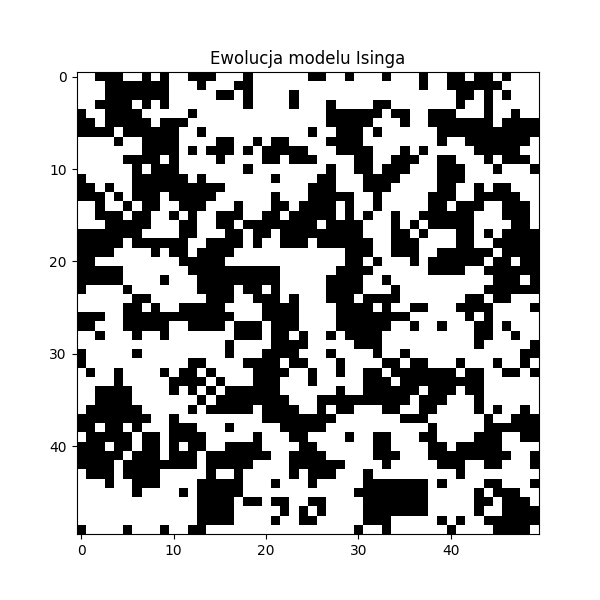

# 2D Ising Model Monte Carlo Simulation

High-performance numerical simulation of ferromagnetic phase transitions on a two-dimensional spin lattice using the Metropolis-Hastings Monte Carlo algorithm, accelerated with Numba Just-In-Time (JIT) compilation.

---

## Animation Preview



---

## Overview

The Ising model is a mathematical model of ferromagnetism in statistical mechanics. This project simulates a 2D square lattice of discrete spin variables $s_i \in \{-1, +1\}$ interacting with their nearest neighbors under periodic boundary conditions.

The system Hamiltonian is given by:

$$H = -J \sum_{\langle i, j \rangle} s_i s_j - B \sum_i s_i$$

where $J$ is the coupling constant and $B$ represents the external magnetic field. The simulation explores the behavior of the lattice across a range of temperatures around the Onsager critical temperature ($T_c \approx 2.269 \, J/k_B$).

### Key Features
- **Metropolis-Hastings Algorithm:** Markov Chain Monte Carlo (MCMC) sampling of spin configurations to reach thermal equilibrium.
- **Numba JIT Acceleration:** Core simulation loops compiled to native machine code using `@njit`, achieving orders-of-magnitude speedup over pure Python.
- **Thermodynamic Observables:** Computation of macroscopic quantities such as average magnetization, internal energy, magnetic susceptibility, and specific heat across temperature gradients.
- **Lattice Visualization:** Dynamic animation and plotting of spin domain formations and phase transition curves.

---

## Numerical Methodology

1. **Initialization:** Generation of an $N \times N$ spin lattice in a random (hot) or aligned (cold) initial state.
2. **Thermalization:** Execution of Monte Carlo sweeps using the Metropolis acceptance criterion $\min(1, \exp(-\Delta E / k_B T))$ until the system reaches equilibrium.
3. **Measurement:** Statistical averaging of magnetization $\vert{}M\vert{}$ and energy $E$ over subsequent Monte Carlo steps for each discrete temperature point.

---

## Setup and Usage

### Prerequisites
- Python 3.9+

### Installation
Clone the repository:
```bash
git clone [https://github.com/FranekJak/ising-model-2d-numba.git](https://github.com/FranekJak/ising-model-2d-numba.git)
cd ising-model-2d-numba
